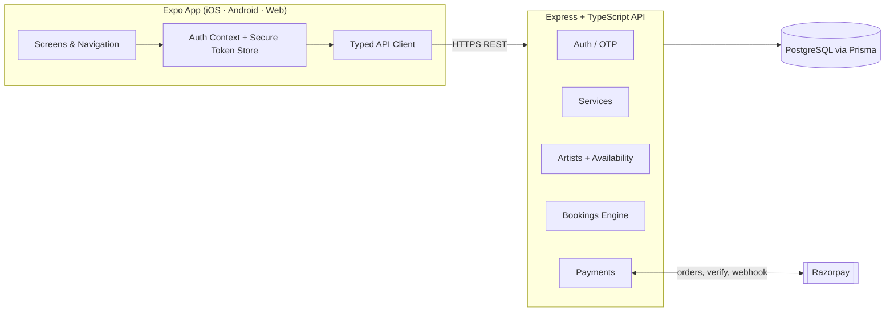

# GlowUp — Makeup Booking Platform 💄

A scalable, cross‑platform (iOS · Android · Web) makeup booking application where
**customers log in with their mobile number**, browse makeup services (Basic ₹600,
Bridal ₹1300, and more), pick an **artist by date & time**, and pay securely via
**Razorpay**. Makeup **artists also log in with their mobile number** to offer
services, set prices, and manage availability.

> One TypeScript codebase for the app (Expo / React Native) + a typed REST API
> (Express + Prisma + PostgreSQL).

---

## ✨ Features

- **Mobile‑number OTP login** for both customers and artists (JWT access + refresh).
- **Service catalogue** with per‑service pricing and duration (e.g. Basic ₹600, Party ₹900, Bridal ₹1300, HD Bridal ₹2500).
- **Artist discovery** filtered by service, city, rating.
- **Nearby search** — artists set their location; customers tap **"Find artists near me"**
  and filter by radius (5–50 km). Results show distance and are sorted nearest‑first to
  cut travel time and cost.
- **Date & time slot booking** — real availability computed from each artist's weekly
  schedule minus existing bookings, with conflict prevention.
- **Razorpay payments** with signature verification + webhook handling, plus a built‑in
  **mock mode** so the whole flow works offline without keys.
- **SMS OTP delivery** via Twilio or MSG91 (with a console fallback for development).
- **Artist dashboard** — artists manage their profile, services & pricing, weekly
  availability, incoming booking requests (accept → in‑progress → complete), and a
  **portfolio gallery** with image uploads.
- **Push notifications** (Expo) for new bookings, status changes, and successful payments.
- **Cross‑platform**: the same app runs on **Android, iOS, and the Web**.
- **Production‑minded backend**: Helmet, CORS allow‑list, rate limiting, compression,
  centralized error handling, Zod validation, graceful shutdown.

---

## 🏗️ Architecture



### Tech stack

| Layer      | Technology                                                        |
| ---------- | ----------------------------------------------------------------- |
| App        | Expo (React Native) + TypeScript, React Navigation                |
| Backend    | Node.js + Express + TypeScript                                    |
| ORM / DB   | Prisma + PostgreSQL                                               |
| Auth       | Mobile OTP + JWT (access/refresh)                                 |
| Payments   | Razorpay (orders + signature verification + webhooks)            |
| Validation | Zod                                                               |

---

## 📁 Project structure

```
makeup_app_web/
├── backend/                     # Express + Prisma API
│   ├── prisma/
│   │   ├── schema.prisma        # DB models (User, Artist, Service, Booking, Payment…)
│   │   └── seed.ts              # Services + sample artists
│   └── src/
│       ├── config/              # env, prisma client, logger, razorpay
│       ├── middleware/          # auth, validation, error handling
│       ├── modules/             # auth · users · services · artists · bookings · payments
│       ├── utils/               # jwt, otp, errors, response helpers
│       ├── app.ts               # Express app wiring
│       └── server.ts            # Bootstrap + graceful shutdown
│
└── app/                         # Expo app (iOS/Android/Web)
    ├── App.tsx                  # Providers + navigation root
    └── src/
        ├── api/                 # client + typed endpoints
        ├── components/          # Button, Card, TextField, Avatar…
        ├── navigation/          # stack + tabs
        ├── screens/             # Login, OTP, Home, ArtistDetail, Booking, Payment…
        ├── store/               # AuthContext
        ├── utils/               # storage, formatting, Razorpay web checkout
        ├── config.ts            # API base URL + Razorpay key
        ├── theme.ts             # design tokens
        └── types.ts             # shared types
```

---

## 🚀 Getting started

### Prerequisites

- **Node.js 18+** (tested on Node 24)
- **PostgreSQL 13+** running locally (or via Docker)
- For devices: the **Expo Go** app, or Android/iOS simulators

Quick PostgreSQL via Docker (optional):

```powershell
docker run --name makeup-pg -e POSTGRES_PASSWORD=postgres -e POSTGRES_DB=makeup_app -p 5432:5432 -d postgres:16
```

### 1) Backend

```powershell
cd backend
Copy-Item .env.example .env        # then edit DATABASE_URL + secrets
npm install
npx prisma generate
npx prisma migrate dev --name init # creates the tables (incl. portfolio + push tokens)
npm run db:seed                    # loads services + sample artists
npm run dev                        # API on http://localhost:4000/api/v1
```

> Already migrated from an earlier version? Re‑run `npx prisma migrate dev` to apply the
> latest schema changes (portfolio, push tokens, and artist latitude/longitude).

Health check: open http://localhost:4000/health

### 2) App (Expo)

```powershell
cd app
npm install
npm run web        # open in the browser
# or
npm run android    # Android emulator / device
npm run ios        # iOS simulator (macOS)
```

> **Pointing the app at the API**
> - Web & iOS simulator use `http://localhost:4000`.
> - Android emulator uses `http://10.0.2.2:4000` automatically.
> - **Physical device:** set your machine's LAN IP, e.g.
>   `EXPO_PUBLIC_API_URL=http://192.168.1.5:4000/api/v1` before `npm run ...`.

---

## 🔐 Logging in (dev)

OTP runs in **dev mode** by default (`OTP_DEV_MODE=true`), so no SMS provider is
needed — the 6‑digit code is returned by the API and shown on the OTP screen.

Seeded numbers you can log in with:

| Role   | Mobile       |
| ------ | ------------ |
| Admin  | `9000000000` |
| Artist | `9811111111` (Aisha), `9822222222` (Priya), `9833333333` (Neha) |
| Customer | any valid 10‑digit number, e.g. `9876543210` (auto‑created) |

Flow: enter number → **Send OTP** → the dev code appears → **Verify** → you're in.

---

## 💳 Payments (Razorpay)

- **Mock mode (default):** with no keys set, the backend issues a mock order and the
  app completes the flow end‑to‑end so you can test bookings → confirmed.
- **Real test mode:** add test keys to `backend/.env`
  (`RAZORPAY_KEY_ID`, `RAZORPAY_KEY_SECRET`) and set
  `EXPO_PUBLIC_RAZORPAY_KEY_ID` for the web app. Web uses Razorpay Checkout.js.
  For **native** live payments, add `react-native-razorpay` in a custom dev build.
- **Webhook:** point Razorpay to `POST /api/v1/payments/webhook` and set
  `RAZORPAY_WEBHOOK_SECRET`.

---

## � SMS OTP, portfolio uploads & push notifications

**SMS provider** (`backend/.env` → `SMS_PROVIDER`):

- `console` (default) — logs the OTP; no account needed.
- `twilio` — set `TWILIO_ACCOUNT_SID`, `TWILIO_AUTH_TOKEN`, `TWILIO_FROM_NUMBER`.
- `msg91` — set `MSG91_AUTH_KEY` and a DLT‑approved `MSG91_TEMPLATE_ID` (India).

With `OTP_DEV_MODE=true` the code is still returned in the response for easy testing.

**Portfolio uploads** are stored under `backend/uploads/portfolio` and served from
`/uploads/...`. Set `PUBLIC_URL` to your API's public URL so image links resolve on
devices (otherwise the request host is used). Swap the disk storage in
[backend/src/middleware/upload.ts](backend/src/middleware/upload.ts) for S3/Cloudinary in production.

**Push notifications** use Expo. The app registers a push token after login
(`/notifications/token`); the backend sends alerts on new bookings, status changes and
payments via the Expo push service. In Expo Go this works out of the box; for standalone
builds, configure an EAS `projectId`.

---

## �📡 API reference (base: `/api/v1`)

| Method | Endpoint                     | Auth     | Description                         |
| ------ | ---------------------------- | -------- | ---------------------------------- |
| POST   | `/auth/otp/request`          | –        | Send an OTP to a mobile number     |
| POST   | `/auth/otp/verify`           | –        | Verify OTP → user + JWT tokens     |
| POST   | `/auth/refresh`              | –        | Refresh access token               |
| GET    | `/users/me`                  | ✓        | Current profile                    |
| PATCH  | `/users/me`                  | ✓        | Update profile                     |
| GET    | `/services`                  | –        | List services (filter by category) |
| GET    | `/artists`                   | –        | List artists (filter by service)   |
| GET    | `/artists?lat=&lng=&radius=` | –        | Nearby artists sorted by distance  |
| GET    | `/artists/:id`               | –        | Artist detail + services           |
| GET    | `/artists/:id/slots?date=`   | –        | Available time slots for a date    |
| GET    | `/artists/:id/portfolio`     | –        | Artist portfolio images            |
| PUT    | `/artists/me/profile`        | ✓        | Create/update artist profile       |
| PUT    | `/artists/me/services`       | artist   | Set offered services + prices      |
| PUT    | `/artists/me/availability`   | artist   | Set weekly availability            |
| POST   | `/artists/me/portfolio`      | artist   | Upload a portfolio image (multipart `image`) |
| DELETE | `/artists/me/portfolio/:id`  | artist   | Delete a portfolio image           |
| POST   | `/bookings`                  | ✓        | Create a booking                   |
| GET    | `/bookings`                  | ✓        | My bookings (customer)             |
| GET    | `/bookings/artist`           | artist   | Bookings for the logged‑in artist  |
| PATCH  | `/bookings/:id/cancel`       | ✓        | Cancel a booking                   |
| PATCH  | `/bookings/:id/status`       | artist   | Confirm / start / complete         |
| POST   | `/payments/order`            | ✓        | Create a Razorpay order            |
| POST   | `/payments/verify`           | ✓        | Verify payment signature           |
| POST   | `/payments/webhook`          | signature| Razorpay webhook                   |
| POST   | `/notifications/token`       | ✓        | Register an Expo push token        |
| DELETE | `/notifications/token`       | ✓        | Remove an Expo push token          |

---

## 📈 Scalability & reliability

- **Stateless API + JWT** → scale horizontally behind a load balancer.
- **PostgreSQL + Prisma** with indexed lookups on mobile, artist/date, customer.
- **Single Prisma client** reused across reloads to protect the connection pool.
- **Rate limiting** on the global API and specifically on OTP requests.
- **Centralized validation (Zod)** and **error handling** for predictable responses.
- **Graceful shutdown** closes the server and DB cleanly on SIGINT/SIGTERM.
- **Payment integrity** via signature verification + idempotent webhook updates.

### Suggested next steps for production

- SMS provider (MSG91 / Twilio / AWS SNS) to replace dev OTP.
- Redis for OTP throttling and caching artist availability.
- Image uploads (S3/Cloudinary) for artist portfolios.
- Push notifications (Expo Notifications) for booking updates.
- CI/CD + EAS Build for store releases; containerize the API for deployment.

---

## Scripts

**Backend** (`/backend`)

| Script            | Purpose                       |
| ----------------- | ----------------------------- |
| `npm run dev`     | Start API with hot reload     |
| `npm run build`   | Compile TypeScript            |
| `npm start`       | Run compiled server           |
| `npm run db:seed` | Seed services + artists       |
| `npm run lint`    | Type‑check only               |

**App** (`/app`)

| Script          | Purpose              |
| --------------- | -------------------- |
| `npm run web`   | Run in the browser   |
| `npm run android` | Run on Android     |
| `npm run ios`   | Run on iOS (macOS)   |
